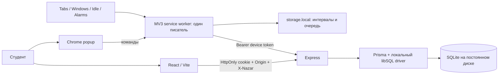

# Архитектура

## Версия 3.1

Базовый поток ниже сохранён. Добавлены: PWA (manifest/SW/public offline fallback), самостоятельные mobile-сессии через тот же API, Nazar Decision с временными исключениями и журналом, Attention Map событий/интервалов, детерминированный Coach, экспорт и добровольная недельная цель. Подготовлены отдельные PostgreSQL schema/client/migrations, Node function api/index.ts и Vercel static-конфигурация; реальные облачные ресурсы не созданы из-за отсутствия разрешения team (deployment.md).

В settle интервал делится на точной границе expiresAt даже при поздней контрольной точке. Старые интервалы не переоцениваются. Исключение until=session переносится вместе с дедлайном после паузы; five-minute until=time истекает по стеновым часам. Journal хранит реальные решения; для старых записей ничего не восстанавливается задним числом. Причина interruption записывается только когда известна: новый запуск worker, checkpoint gap >45 секунд или часы назад. Серые интервалы карты означают отсутствие измерения сайта, а не доказанное отвлечение.

Mobile использует timestamps с host=null и source=mobile; сервер запрещает ему интервалы сайтов. Очередь хранится под ключом владельца; ownerId дополнительно сравнивается с авторизованной cookie. Переключение аккаунта в другой вкладке не отправляет чужую очередь. PWA кеширует публичные ресурсы, не API/авторизованный HTML. Фоновый мониторинг чужих приложений не заявляется.

Новый RateLimit store использует атомарные upsert в общей БД, ключ содержит хеш IP, просроченные окна очищаются. На Vercel обязательна постоянная PostgreSQL; file: URL отвергается. Локальная SQLite сохранена, перед миграцией — VACUUM INTO + integrity_check + ZIP/SHA-256. Перенос в PostgreSQL необязательный, требует явного target, transaction/count checks; в этой работе личные данные не переносились.

## Модули и поток данных

- shared: Zod-контракты, домены, временная логика, расчёты по дням.
- extension/worker: состояние, сериализация, контрольные точки, история, очередь. Popup — только команды и отображение. Нет content scripts и удалённого исполняемого JS.
- api: проверка credential, владельца, instanceId, валидация, сохранение, отчёты. Prisma 7 с локальным libSQL — файл SQLite, внешний сервис не нужен.
- web: лендинг/кабинет, данные только API; dev proxy, в сборке Express static.

## Модель учёта

Сессия хранит startedAt, deadline, plannedMs, elapsedMs, pausedAt, cursor, host, lastCheckpoint. UTC epoch milliseconds; отображение в IANA timezone, по умолчанию Asia/Almaty.

Перед сменой контекста settle закрывает `[cursor,min(now,deadline))`, затем выбирается следующий host. Максимум одна активная вкладка сфокусированного обычного окна; равные смежные интервалы объединяются. Смена URL в той же вкладке, активация, закрытие вкладки, фокус окна, idle и locked пересчитывают контекст. Popup не владеет таймером. Мутации сериализованы цепочкой Promise.

Потеря фокуса/idle останавливает время сайтов, но elapsedMs и дедлайн продолжаются. Пауза останавливает оба счётчика, resume переносит deadline на длительность паузы. Исключение закрывает прошлый интервал и действует с момента выбора; прошлое не переоценивается. Настройки копируются при старте. Домены сопоставляются exact или суффиксом с точкой: notyoutube.com не совпадает с youtube.com.

Idle после 120 секунд без ввода — эвристика: чтение тоже может исключаться. Контрольные точки 15 секунд best-effort, alarm каждые 30 секунд. Новый запуск worker прерывает активную сессию с подтверждённым результатом. Разрыв >45 секунд/часы назад также прерывает без начисления неизвестного разрыва. Обычная остановка worker может вызвать консервативное прерывание. Короткий сон до порога не всегда отличим от задержки; абсолютная точность не обещается.

API обрезает интервалы по диапазону и splitDays находит локальную полночь двоичным поиском через Intl, включая DST. Время распределяется по фактическим дням, число сессий — по завершению в запрошенном диапазоне. Interrupted входит в общее sessions, completed считается отдельно.

## Синхронизация

Настройки загружаются перед стартом; офлайн допустим с последним снимком, 401 требует нового подключения. Итог и очередь сначала сохраняются одним объектом storage, затем выполняется PUT. Элемент удаляется только после подтверждения. Backoff 30 секунд–1 час, alarm проверяет раз в минуту; ручная синхронизация игнорирует задержку.

Очередь привязана к ownerId + instanceId. A не отправляется токеном B; повторное подключение A позволяет отправить его старые данные. Истёкший токен не удаляет очередь. Очистка из popup касается текущего аккаунта; история Chrome не трогается. Удаление аккаунта не перепривязывает локальный результат к новому аккаунту.

UNIQUE(userId,clientSessionId) и атомарная запись исключают дубль. SHA-256 нормализованного Zod payload сравнивает повторы: тот же → 200 и прежний id, другой → 409. Гонка ловится уникальным индексом. Статистика вычисляется из записей, накопительного счётчика нет. Обмен кода и создание устройства — транзакция.

## Защита

Пароли Argon2id (19 MiB, 2 прохода, parallelism 1). Cookie и bearer — 32 случайных байта crypto.randomBytes; в БД SHA-256. Web cookie HttpOnly/SameSite Strict, срок 7 дней; production Secure и __Host- префикс. Мутации требуют X-Nazar:1, cookie-мутации — разрешённый Origin. CORS конкретный; production HTTPS reverse proxy. Код подключения 96 случайных бит, хеш в базе, 5 минут, одно использование. Device token 30 дней, отзыв владельцем, storage TRUSTED_CONTEXTS.

API сам выводит владельца из credential. Запись отчёта требует устройство с совпадающим instanceId. Чтение/изменение/удаление ограничены владельцем. Удаление аккаунта повторно проверяет пароль. Rate-limit: вход/регистрация/подключение 30/15 минут, API 240/минуту; JSON до 2 MiB, схемы ограничивают данные. Логи не содержат секретов/истории. Отдельное согласие нужно для серверной сводки истории; полные URL/заголовки не входят в контракт.

## Ограничения

Локальный API и подготовленный serverless API используют общий rate-limit в БД. Несколько устройств поддерживаются авторизацией, но пересекающиеся сессии разных устройств не дедуплицируются. Нет email verification/восстановления пароля, антифрода, платежей, AI и жёсткой блокировки. Клиентские данные не являются защищённой телеметрией для рейтингов/денег. SQLite и большие интервальные отчёты требуют дальнейших нагрузочных испытаний. Публичное размещение требует постоянного диска и резервных копий.
